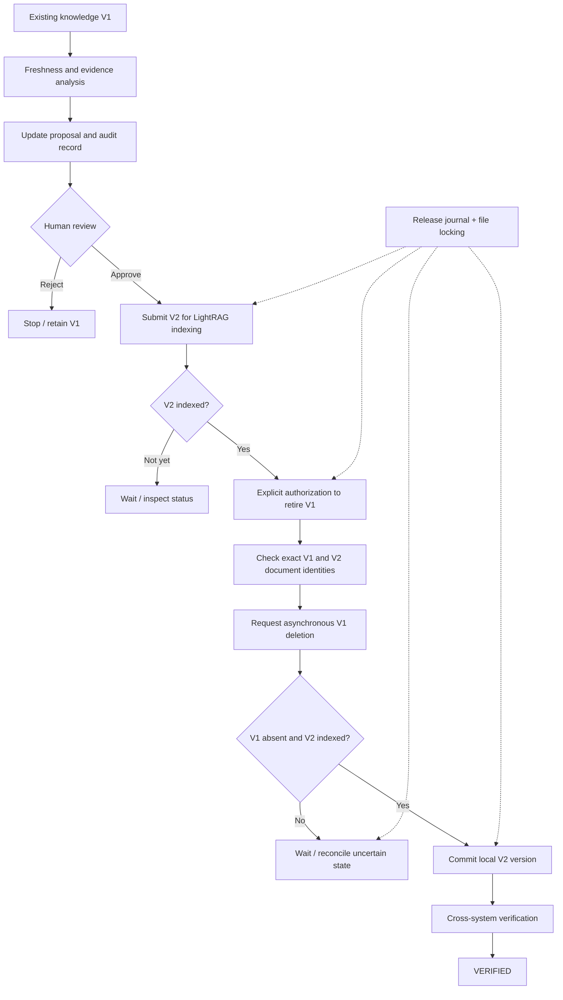

# DeerFlow KnowledgeOps — Enterprise Knowledge Governance MVP

> A knowledge lifecycle and controlled release layer built on top of [DeerFlow](https://github.com/bytedance/deer-flow) and [LightRAG](https://github.com/HKUDS/LightRAG).
>
> 基于 DeerFlow 与 LightRAG 的企业知识治理 MVP：从证据分析、更新提案、人工审批，到版本化索引、受控下线、故障核对和发布验证。

## Why this project?

Traditional RAG answers **what knowledge can be retrieved**. Enterprise knowledge systems must also answer **whether that knowledge is current, supported by evidence, approved, and safe to update**.

KnowledgeOps focuses on the *knowledge lifecycle*, rather than reimplementing the underlying RAG engine. This repository is a **DeerFlow-based fork**; the KnowledgeOps functionality is the custom extension.

## Architecture



## Implemented functionality

| Area | Implementation |
| --- | --- |
| Knowledge assessment | Freshness policies, rule-based trust/evidence scoring, source analysis and audit helpers |
| Controlled updates | Versioned knowledge history, change proposals, explicit human approval/rejection |
| RAG integration | LightRAG text submission, asynchronous indexing-status tracking and exact document identity checks |
| Release workflow | State-driven V2 indexing, explicit V1 retirement authorization, local publication and final verification |
| Reliability | Local Linux file lock, journaled release state, safe stop on uncertain outcomes, read-only deletion inspection and limited interrupted-commit recovery |
| Developer tooling | Python CLI, Ruff checks, pytest and GitHub Actions CI |

The trust score is a **rule-based heuristic**, not an empirically calibrated probability of truth. The release workflow is an **MVP**, not a production-grade distributed transaction system.

## Repository layout

```text
backend/packages/harness/deerflow/community/knowledgeops/
├── agent_tools.py             # Agent-facing investigation tool
├── analyzer.py                # Evidence and claim analysis
├── audit.py                   # Audit report generation
├── tools.py                   # Freshness / scoring tools
├── knowledge_versions.py      # Version history
├── proposals.py               # Change proposal creation
├── proposal_review.py         # Human review
├── knowledge_release.py       # Local publication / rollback
├── lightrag_sync.py           # LightRAG integration
├── release_workflow.py        # Indexing submission / tracking
├── release_retirement.py      # Controlled old-version deletion
├── release_finalization.py    # Publication after retirement
├── release_orchestrator.py    # Locked state-driven orchestration
├── release_recovery.py        # Uncertain-state inspection/recovery
└── release_cli.py             # Command-line interface

backend/tests/test_knowledgeops_*.py
.github/workflows/knowledgeops-ci.yml
```

## Local setup and checks

Prerequisites: Python/uv dependencies from the parent DeerFlow project; Docker Desktop with WSL2 integration; a separately deployed LightRAG server. Configure model and LightRAG credentials locally in `.env` (never commit secrets).

```bash
cd ~/deerflow-knowledgeops/backend
uv run ruff check packages/harness/deerflow/community/knowledgeops tests/test_knowledgeops_*.py
uv run ruff format --check packages/harness/deerflow/community/knowledgeops tests/test_knowledgeops_*.py
uv run pytest -q tests/test_knowledgeops_*.py
uv run python -m deerflow.community.knowledgeops.release_cli --help
```

The project had **58 local automated tests passing** at the time this document was prepared; GitHub Actions on `knowledgeops-dev` was also successful. Most automated cases use mocks. A separate live demonstration exercised the real LightRAG API.

## CLI usage

Replace `<PROPOSAL_UUID>`, `<KNOWLEDGE_UUID>` and `<OLD_TRACK_ID>` with IDs from **your own demonstration dataset**. The data directory must contain `journals/`, `knowledge/`, and `proposals/`.

```bash
cd ~/deerflow-knowledgeops/backend

# Read local release state (non-destructive)
uv run python -m deerflow.community.knowledgeops.release_cli status \
  --proposal-id <PROPOSAL_UUID> --data-dir ~/knowledgeops-demo-e2e

# Start V2 indexing (writes to LightRAG; run only once per proposal)
uv run python -m deerflow.community.knowledgeops.release_cli start \
  --proposal-id <PROPOSAL_UUID> --knowledge-id <KNOWLEDGE_UUID> \
  --data-dir ~/knowledgeops-demo-e2e

# Advance the workflow / inspect indexing (state-dependent)
uv run python -m deerflow.community.knowledgeops.release_cli advance \
  --proposal-id <PROPOSAL_UUID> --data-dir ~/knowledgeops-demo-e2e
```

**Destructive operation:** Only after verifying the exact original document and obtaining explicit authorization, the `advance` command with `--old-track-id <OLD_TRACK_ID> --allow-retirement` requests deletion of the old LightRAG document. **Never blindly repeat a destructive command** after a timeout or unknown response. Use read-only inspection/reconciliation first.

The `inspect` action checks uncertain deletion state without reissuing deletion; `recover` is limited to cases where the local publish fully committed but the journal was not finalized.

## Verified live demonstration (synthetic data)

A fictional **Northstar Labs** knowledge item was changed from an internal release marker of `Silver Otter 619` (V1) to `Copper Fox 853` (V2). The demo used a human-approved proposal, real LightRAG indexing, controlled retirement and a final consistency check.

```json
{
  "status": "VERIFIED",
  "current_version": 2,
  "old_index_status": "NOT_FOUND",
  "new_index_status": "INDEXED",
  "local_publication": "CONFIRMED"
}
```

This shows successful consistency checks for the specified local version and LightRAG tracking records. It does **not** establish factual correctness of real company data, production reliability, concurrent load performance or absence from every possible downstream cache.

## Safety and limitations

- The demonstration uses **synthetic data**, not confidential enterprise records.
- Rules-based evidence/trust scores require domain-specific validation and should not be interpreted as ground-truth probabilities.
- `fcntl` locking protects the single-host orchestration entry point, **not** distributed workers or every direct low-level call.
- Some unknown/degraded states intentionally require human reconciliation; the system does not auto-retry uncertain destructive requests.
- The CLI is an engineering interface, not a complete enterprise authentication/permissions UI.
- API keys and local execution data should remain outside version control; sanitize screenshots before publication.

## Future work (not claimed as implemented)

Full crash consistency across all storage boundaries, distributed coordination, permission-aware approval UI, retrieval quality benchmarks, calibrated trust scoring and production monitoring.

## Attribution

Built as an independent KnowledgeOps extension to the open-source DeerFlow project, integrating LightRAG as the retrieval/indexing backend. The underlying projects belong to their respective maintainers; this document describes the custom KnowledgeOps work rather than presenting the entire DeerFlow codebase as original.
